# Ninjune's FPS Improvement Guide

## Who am I
[Streamer](https://www.twitch.tv/ninjune1), Voltaic Grandmaster, t500 dps in marvel rivals, masters in ow before rivals. I started silver in overwatch 2 (in 2024) and gold in voltaic (in 2025).

[kova page](https://kova.page/ninjune)

## What to do

### Kovaaks
[evxl.app](https://evxl.app) search your name then voltaic s5, viscose s2, aimerz+, jade palace are all good. Hit the sharecode button at the top for the playlist code. 

### Aim Labs
I don't regularly play Aim Labs but I would suggest voltaic and their ranked mode/benchmarks. 

*TODO: Develop more*

## Settings
You should be critical of the settings you use ingame/kovaaks. For example, I use the caps lock key for some abilities in rivals because I can hit it with my pinky finger and it allows me to use my other fingers for movement while I use that ability. Thinking of little things like this stacks up over time and makes you a better player overall.

[Kovaaks settings in depth matty video](https://youtu.be/ZOEOVSlUKcc)

[Kovaaks Visual Themes](https://docs.google.com/spreadsheets/d/1T3SErnsYZqQpZ8HKDPRB41hqcEtL6SAc9GoA4YAtiSU/edit?pli=1&gid=0#gid=0)

*TODO: Develop more*

### Sensitivity
cm/360 is universal measurement for sensitivity, put your sens into the sensitivity thing in kovaaks then set your dpi in the cogwheel then change it to cm/360. [You're okay to change per scenario or whenever](https://youtu.be/C09boe1qJF4). Changing it helps develop different muscle groups (arm, wrist, ftip). 

general recommended range for rivals: 30-60cm/360

## Peripherals
Mouse, mousepad, monitor, **mouse skates** are all important. The general advice is "use whatever is comfortable," but certain mice are better than others and it is noticable. For example, op1 8k, xbab xa25 sensor > fenrir pro for me; the shape of op1 wasn't good enough to beat the fenrir though so I used the fenrir for awhile. 

### Priority Order for Buying a Mouse:
1. shape
2. sensor
3. wired vs wireless
     - wireless should be preferred theoretically, but wired mouse often have better sensors.

### Skates
artisan p8s, forkymod teal, ultraglide silence, xraypad jade (all dots) are some of my favorites. [Tier list](https://docs.google.com/spreadsheets/d/1EUffzKOidRJ1W3-I1ocRd7yE_QDqXL58rUTOyC5ZBj4)

### Setup
Chair/desk height is important; your desk should be at your belly optimally ([source](https://www.youtube.com/watch?v=EqeDWH4kcME&t=1s)). I don't use arm rests & took them off. You should have enough desk room to use a full 50cm x 50cm mousepad. 

## Tips

### General
- **Actively think** about what technique you want to improve on during your game.
  - You can zone out but it is less effective for the time you put in.
    - I listen to podcast/music while playing usually though. If you do, put it on low volume. VCs are usually too distracting for me.
  - In ranked, I usually **focus on one technique** to improve on personally.
    - This usually changes per game or even per fight if I notice something different.
    - Some examples:
      - who should I be shooting right now? (tanks or dps or backline)
      - where should I walk/play?
      - am I using x ability enough?
      - am I underaiming currently?
      - is my tension okay?
  - In my experience, if you want to play at your best, it is better to only trust your instinct on micro and think only of macro (ults, where your team is, what the state of the fight is).
    - Would recomended doing this during scrims/tourneys and focus on yourself in ranked
  - See [inner game of tennis](https://www.youtube.com/watch?v=jgP_32xUslY)
- "how much I should play"
  - Kovaaks: 30min - 1hr **every day**
    - You can play more or less it doesn't really matter imo, being **consistent** is the most important.
    - Possibly playing excessively like 6+ hrs can be bad for your muscles
  - Ingame: 1hr at least, 4hrs optimally, more is just extra
    - Taking day long breaks is bad but burn out is worse so choose at your own discretion.
    - Any longer than 4hr you wont have the mental energy to learn more.
- Your body health matters more than you think.
  -  **7+ hours of sleep is REQUIRED** if you want to improve.
  -  You have to **eat food** and **drink water** often.
  -  I don't exercise but it's probably meta.
- **Watch vods** 
  - of better players to see how they implement technique
    - Search scenario name on youtube.
    - Look at how fast they move the crosshair, which targets they shoot, where they place their crosshair, which muscle groups they are using, etc.
    - Act like you're playing the game and think of "would I have done this?" 
  - of yourself (ranked)
    - think about missed opportunities and mistakes.
    - think about the wincons of each team each fight.
- Make friends with players that are better than you and you will passively learn from them.
    
### Mental
You need a good mental while playing if you want to improve.
[This video](https://www.youtube.com/watch?v=o9-H6URkfDc) has a good explanation of mental in esports, but below is the most important parts. [Inner game of tennis](https://www.youtube.com/watch?v=jgP_32xUslY) is also very important.

- You MUST **accept that some things are out of your control.**
  - You will have bad days, weeks, months, but it will get better.
  - **Do not** focus on your teammates, you need full attention on the game if you want to improve. ([Eskay on toxicity](https://www.youtube.com/watch?v=mzjtNiceSzU))
  - Your goal is not to win, but to get better.
    - First you get better, rank will follow.
- **Avoid excuses** (e.g. no heals, tanks were useless, etc.)
  - "Drop the ego focus on the grind."
- **Improvement is not a linear process**; you will lose before you win at every point in your journey. Trust the process.
- Remember: not only do you need to improve to climb, you need to improve *faster* than everyone else.
- Anyone can get t500, anyone can get good aim (probably at least VT Astra).
  - **"Genetics" aren't real** when it comes to aiming and games (unless you have a disability possibly), skill is a result of hard work. ([matty on talent](https://youtu.be/-iGJgOC6JwQ))
- Improving in FPS games/aim is a long process that will take months/years.
  - **"How do you climb a mountain? One step at a time."**
  - Don't expect to find easy shortcuts that will instantly make you a god.
  - I have thousands of hours between aim trainers, rivals, and overwatch. 
  - You have to be consistent if you want to improve 
- **Dont compare yourself to others.**
  - Different people grew up in different circumstances and have different mentals, friends, coaches, playtime, what equipment have they been using, etc.
  - It is your journey, only compare yourself to who you were before and see how far you've come.
  - [AimerLew on consistency + comparing yourself to others](https://youtu.be/4V45BMZcAhU)

###  Technique

- [Tension management video](https://www.youtube.com/watch?v=9JoDMDXVTcg)
  - this video is essential to improving in aim.
  - it should be the main thing you focus on when you're starting out and when you play a new scenario
- [Grip video](https://www.youtube.com/watch?v=RvhniU-CJXU)
- [static video](https://www.youtube.com/watch?v=B0Y1KSYxuo4)
- [Capitology on watching vods](https://www.youtube.com/watch?v=_pv_dhja-4w)
- Play a **wide variety** of scenarios
  - Search for variations of scenarios that you are currently playing (20% slower, etc.).
  
*TODO: Develop more*

## Resources

### Guides
- [mattyow beginner video](https://www.youtube.com/watch?v=1-9TiZvbYi0&list=PLJJwQ02KYw9w)
- [Viscose beginner video](https://www.youtube.com/watch?v=yqyy4j32hWk)

### Youtube

Note: Think critically about everything you consume, if it is worth implementing, and how you can implement it.

#### Aim
[ViscoseOCE](https://www.youtube.com/@ViscoseOCE)
[MattyOW](https://www.youtube.com/@mattyow777)

You can probably learn everything in aim from these two alone. but here are some extras for more information.

[AimerLew](https://www.youtube.com/@AimerLew)
[bardoz](https://www.youtube.com/@Bardolo)
[minigodcs](https://www.youtube.com/@minigodcs)
[Lowgravity56](https://www.youtube.com/@Lowgravity56)
[Nomy](https://www.youtube.com/@nomy_)
[Raw Input (Podcast)](https://www.youtube.com/@rawinputpodcast1)

#### OW/rivals
Information from OW (generally) applies to rivals. They also talk about mental a lot which applies to every esport, so that's why I have listed them.

[Spilo](https://www.youtube.com/@CoachSpilo)
[WizardHyeong](https://www.youtube.com/@wizardhyeong)
[Capitology](https://www.youtube.com/@capitology)

[Denis](https://www.youtube.com/@RAD_Denis)

### Discord
[Voltaic](https://discord.gg/voltaic)
[Raw Input](https://discord.gg/rawinput)
[Jade Palace](https://discord.gg/AEXYqCbWV)

### Jade Palace Technique Image Guides

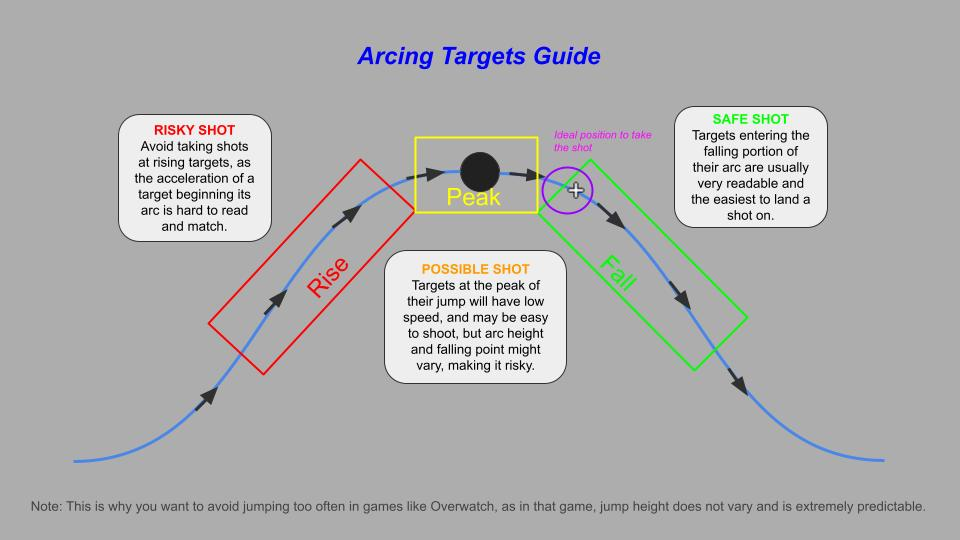
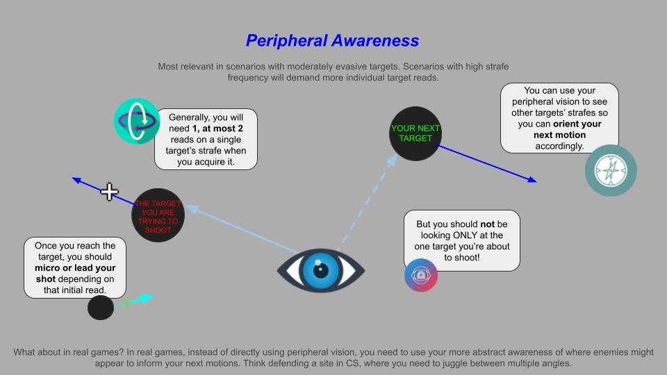
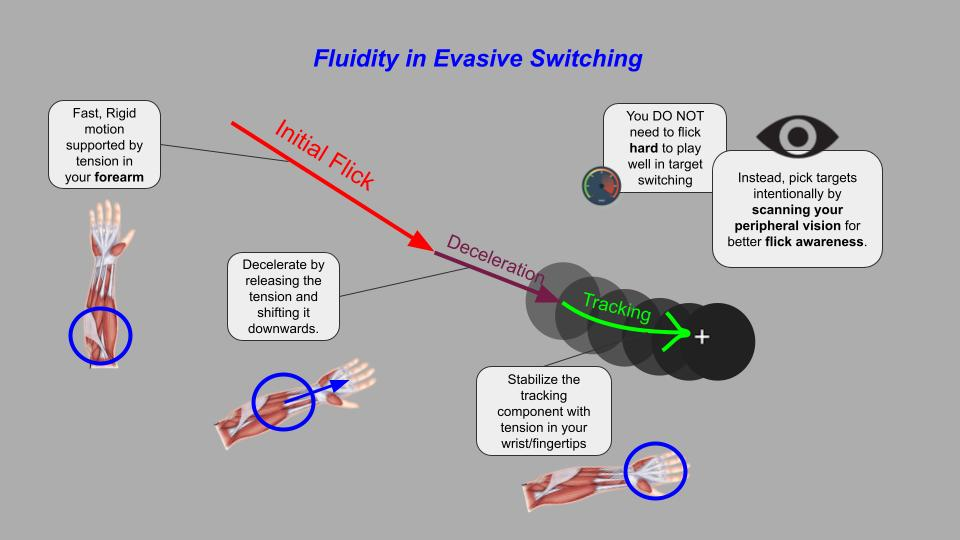
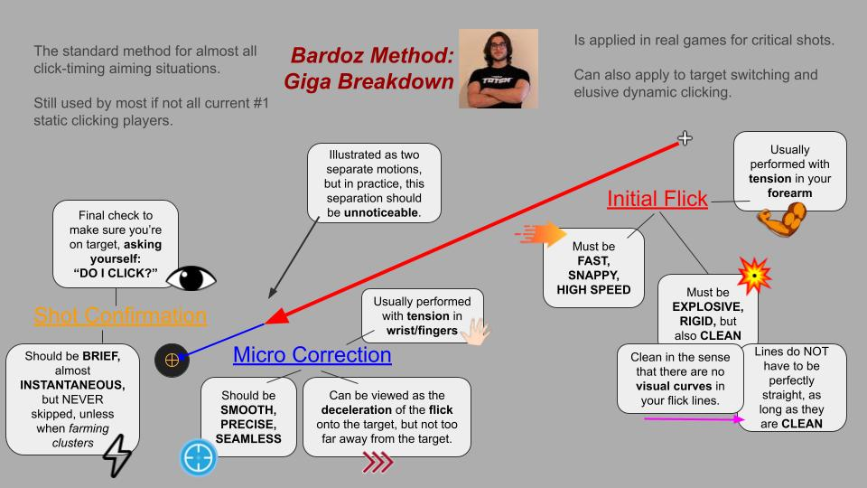
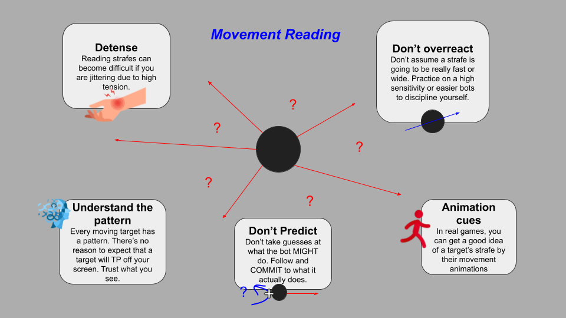
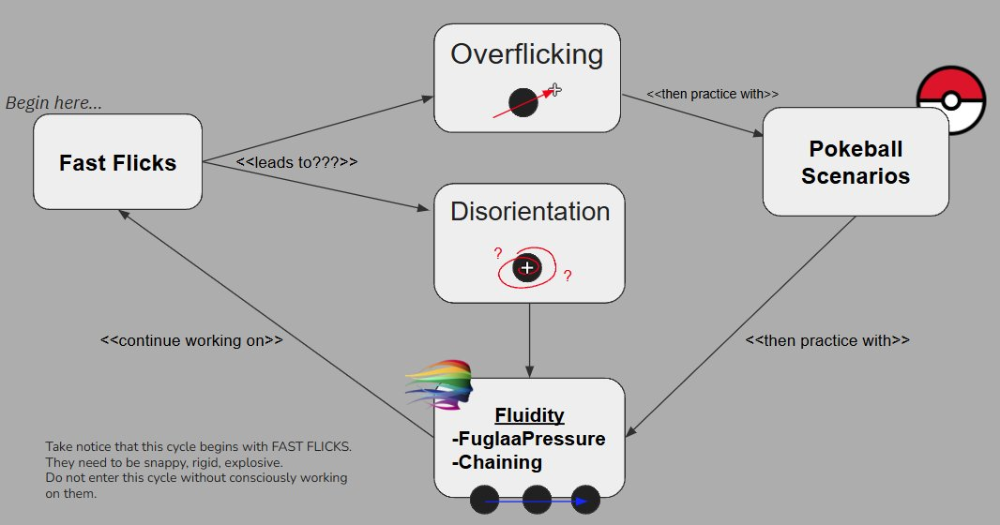
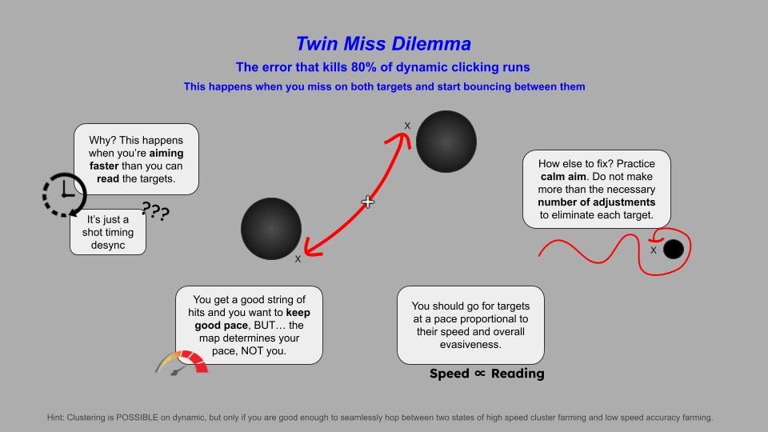

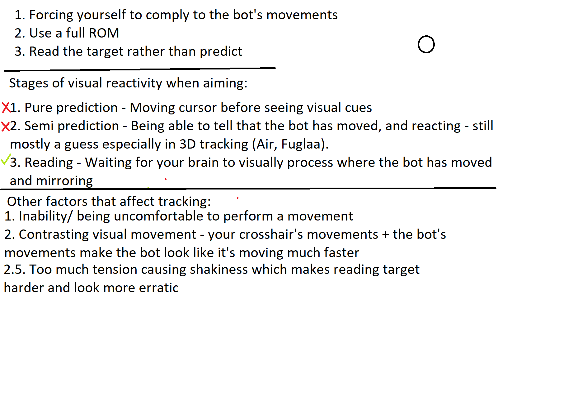
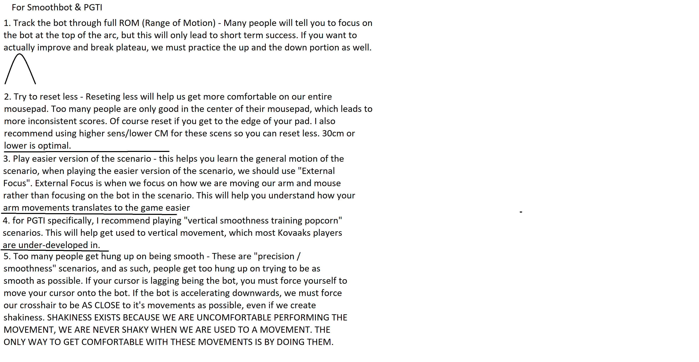
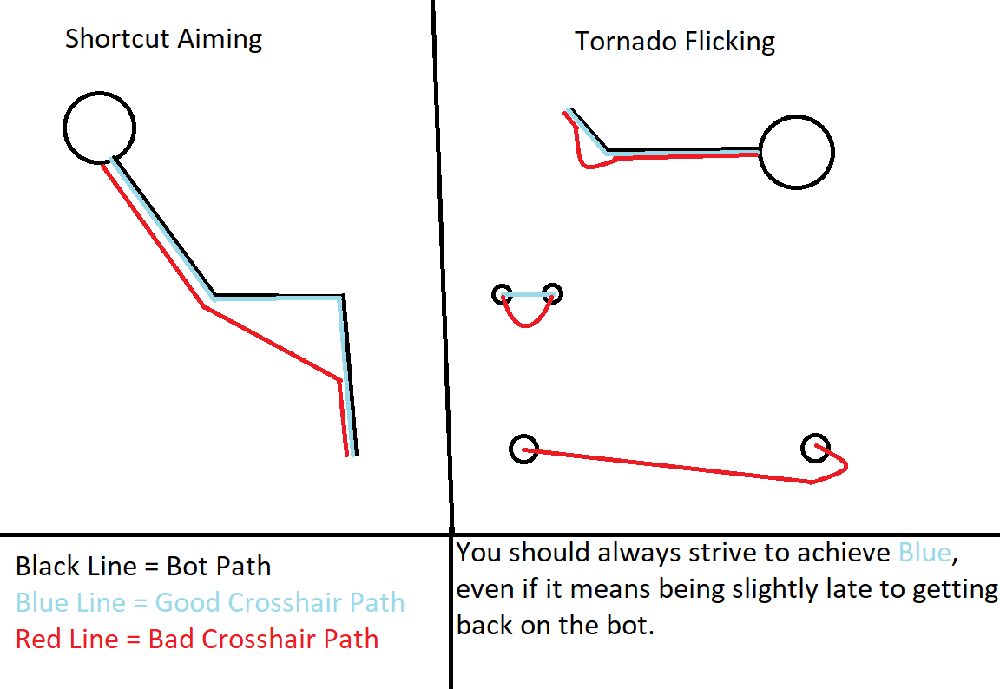

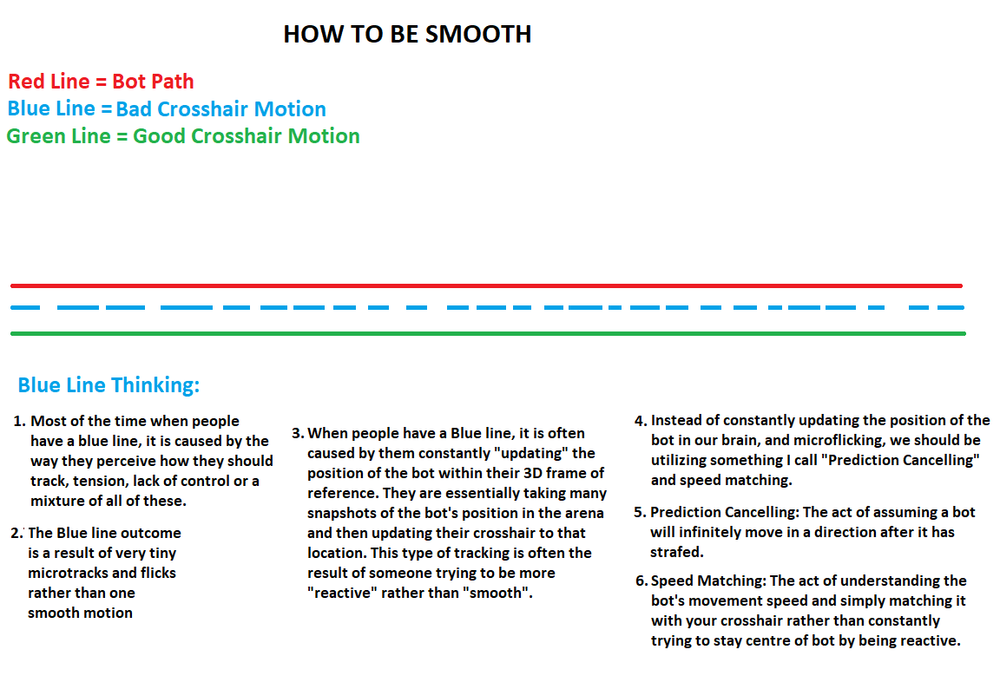
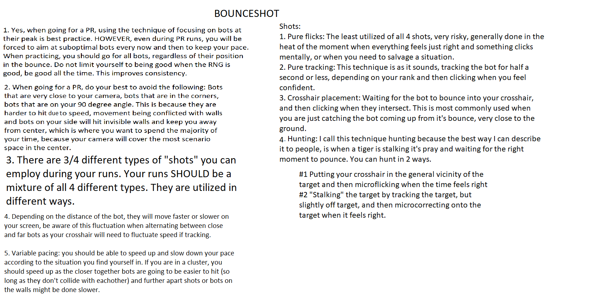
